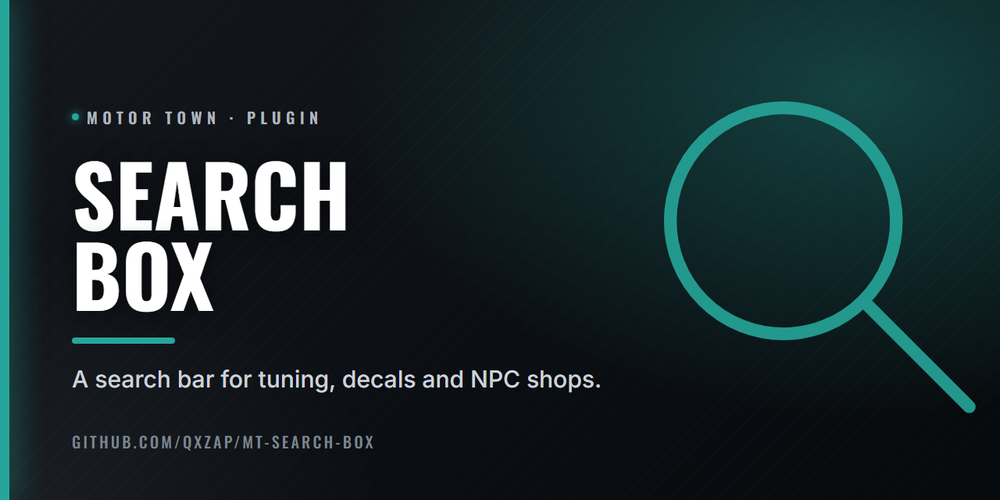

  

# Search Box

Plugin that adds a search bar to the game UI: tuning, decals and NPC shops.

Adds a search bar in various places of the game's UI:

- tuning (the garage part lists: engines, bumpers, wheels and the rest)
- decals
- NPC shops

Every word typed must appear in the name, in any order. Decals have no display name, so those match on their row name.

Engine lists also get Gasoline, Diesel and Electric checkboxes: all ticked, untick one to hide that fuel.

## Install

Needs [Plugin Loader](https://github.com/qxZap/mt-plugin-loader) (`version.dll`) in
`MotorTown\Binaries\Win64\`. Put `mt_plugin_SearchBox.dll` in `MotorTown\Binaries\Win64\plugins\`.

## Build

`build.bat` (MSVC 2022, x64) writes `out\mt_plugin_SearchBox.dll`.
